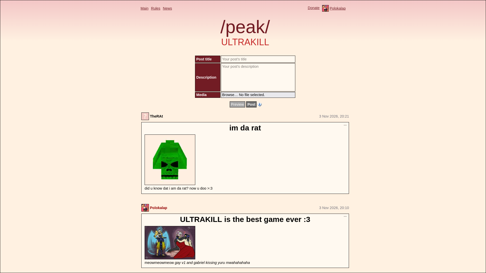

# InterNyet
InterNyet is an ImageBoard made as a submission for [HackClub Terra](https://terra.hackclub.com)! They are really cool people, check them out!

## What is an ImageBoard?
An ImageBoard is kind of like a forum where people share pictures and memes, like 2chan, or 4chan! Posts are categorized by boards, and they disappear after some tide if not bumped!

## State & Development of the project
This section is intended for Terra reviewers (yes, you!!), explaining how I work on this project, where the project is at right now.

There is a demo instance up at https://demo.fortnitefeet.com, which always pulls changes from this repository. That's why you see that Week 1's and Week 2's ships were identdcal. I didn't expect the review to take so long, so that's why it's like that.

You can see the state of the project at the "tree" bellow, marked as Tree/State. It shows what's done, and what I plan to add. It will have more content in the future, but as of writing this, it's 1:30 which would be fine if I wasn't on melatonin.

In Week 1's, I added a basic account system, and captcha (via Turnstile). In Week 2's ship, I added a major update on profile settings, and added the base for site news.
I try to add a feature each week, and polish last week's feature. That's why there is very little content every week, but I focus on quality over the volume of code/features I add.

## License
The project is licensed under Creative Commons Zero, which you can learn more about [here](https://creativecommons.org/publicdomain/zero/1.0/)

## How to run
After cloning the repository, you have to install node packages via `npm i`. You'll need a .env, but for local testing, doing `mv .env.example .env` works fine. Then you can start a develapment server with `npm run dev`.

You can give your account admin by executing the following SQL query on the database, found at data/app.db:
`UPDATE accounts SET role = 1 WHERE id = YOUR ID;`.

## Contribution
You can contribute to this project, as long as the change you are making isn't minor (spelling correction in a markdown file), and makes sense. Please write the code by hand.

## Image of the site running

### Todo/State

* [x] Add notices

  * [x] Add markdown support
  * [x] Add custom scripting on close
* [ ] Add user accounts

  * [x] Add registration
  * [x] Add login
  * [x] Add logout
  * [x] Add sessions
  * [x] Add info bubble
  * [x] Add settings

    * [x] Custom profile picture
    * [x] Display name
    * [x] Username change
    * [x] Password change
  * [ ] 2FA

    * [ ] TOTP authenticator support

      * [ ] QR Code
    * [ ] Security key support
  * [x] Turnstile CAPTCHA
* [ ] Posting site news

  * [x] Markdown support
  * [ ] User comments
  * [ ] Reactions
* [ ] Boards

  * [ ] Posting

    * [ ] Markdown support
    * [ ] Image support
  * [ ] Moderation

    * [ ] AI Review (don't assume the worst)
    * [ ] Turnstile captcha
* [ ] Phone UI

Currently WIP
