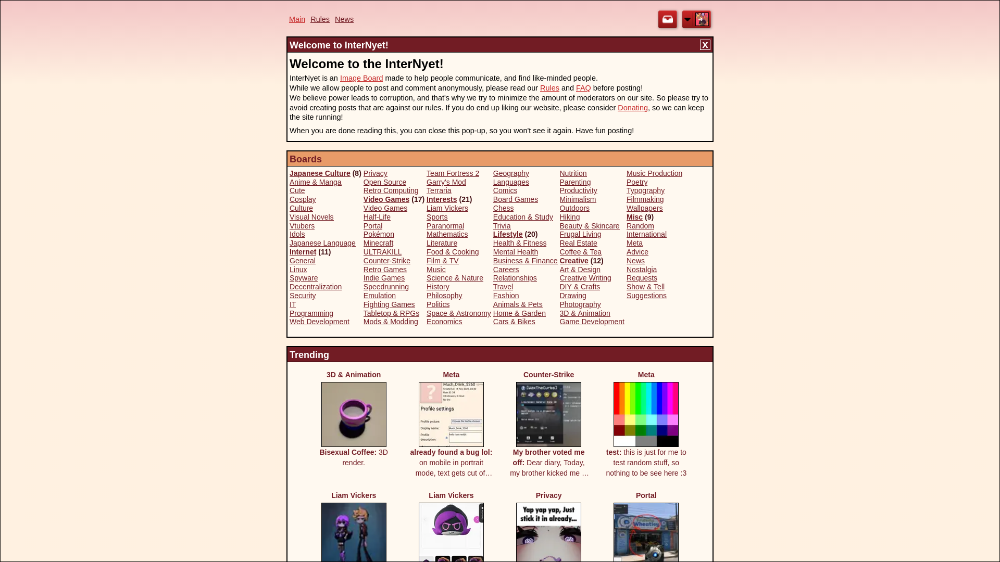

# InterNyet

---

InterNyet is an ImageBoard made as a submission for [HackClub Terra](https://terra.hackclub.com)! They are really cool people, check them out!

## What is an ImageBoard?
An ImageBoard is kind of like a forum where people share pictures and memes, like [2chan](https://www.2chan.net/), or [4chan](https://4chan.org)!

## License
The project is licensed under Creative Commons Zero, which you can learn more about [here](https://creativecommons.org/publicdomain/zero/1.0/)

## How to run
After cloning the repository, you have to install node packages via `npm i`. You'll need a .env, but for local testing, doing `mv .env.example .env` works fine. Then you can start a develapment server with `npm run dev`.

You can give your account admin by executing the following SQL query on the database, found at data/app.db:
`UPDATE accounts SET role = 1 WHERE id = YOUR ID;`.

## Contribution
You can contribute to this project, as long as the change you are making isn't minor (spelling correction in a markdown file), and makes sense. Please write the code by hand.
